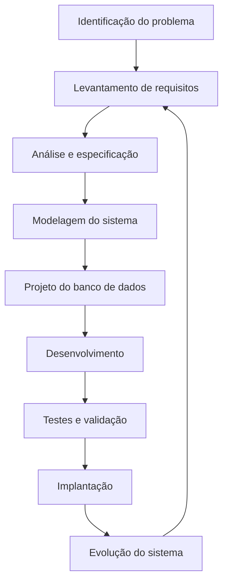

# 🏋️ Sistema Web para Gestão de Academia

<p align="center">
  <strong>Projeto Integrador — Análise e Desenvolvimento de Sistemas</strong><br>
  Faculdade de Tecnologia de Lins – FATEC Lins
</p>

<p align="center">
  
  
  
  
</p>

---

## 📌 Sobre o projeto

O **Sistema Web para Gestão de Academia** é um projeto acadêmico desenvolvido no âmbito do curso superior de Tecnologia em Análise e Desenvolvimento de Sistemas da Faculdade de Tecnologia de Lins – FATEC Lins.

A proposta consiste no planejamento e desenvolvimento de uma plataforma web destinada a centralizar e integrar os principais processos administrativos e operacionais de uma academia.

O sistema busca reunir, em um único ambiente, informações relacionadas a alunos, funcionários, professores, modalidades, planos, matrículas, mensalidades, pagamentos, treinos, controle de acesso e relatórios gerenciais.

O desenvolvimento foi planejado de maneira incremental e multidisciplinar, permitindo que o projeto evolua ao longo dos semestres da graduação, incorporando os conhecimentos adquiridos nas diferentes disciplinas.

**Mais do que desenvolver um software, o objetivo é acompanhar todo o ciclo de vida de um projeto de desenvolvimento de sistemas**, desde a identificação de um problema real até sua análise, especificação, modelagem, implementação, testes e evolução.

## 🎯 Problema identificado

Muitas academias utilizam planilhas, documentos físicos, sistemas independentes ou processos manuais para administrar suas atividades.

Essa fragmentação pode ocasionar:

- Informações de alunos espalhadas em diferentes ferramentas.
- Dificuldade no acompanhamento de matrículas e planos.
- Falta de controle centralizado de mensalidades e pagamentos.
- Dificuldade na identificação de alunos inadimplentes.
- Retrabalho em atividades administrativas.
- Dificuldade de acesso ao histórico individual dos alunos.
- Falta de integração entre recepção, administração e professores.

A proposta é solucionar esse cenário por meio de uma plataforma centralizada, organizada e preparada para futuras expansões.

## 💡 Solução proposta

Desenvolver uma aplicação web responsiva que permita administrar as principais atividades de uma academia, oferecendo diferentes funcionalidades de acordo com o perfil e as permissões de cada usuário.

A solução foi planejada considerando seis áreas principais:

1. Autenticação e controle de acesso.
2. Gestão de alunos e matrículas.
3. Gestão financeira.
4. Gestão de profissionais e treinos.
5. Controle de acesso físico.
6. Relatórios e administração.

A arquitetura deverá permitir que os módulos sejam desenvolvidos e integrados progressivamente.

---

## 🎯 Objetivos do projeto

### Objetivo geral

Desenvolver um Sistema Web para Gestão de Academia, aplicando os conhecimentos adquiridos durante a graduação em Análise e Desenvolvimento de Sistemas nas diferentes etapas do ciclo de vida de software.

### Objetivos específicos

- Compreender e analisar um problema de negócio.
- Identificar as necessidades dos usuários.
- Realizar levantamento e especificação de requisitos.
- Identificar atores, processos e regras de negócio.
- Desenvolver histórias de usuário e casos de uso.
- Elaborar diagramas e modelos de sistemas.
- Planejar a arquitetura da aplicação.
- Projetar e implementar um banco de dados relacional.
- Desenvolver funcionalidades administrativas e financeiras.
- Aplicar conceitos de programação e engenharia de software.
- Implementar mecanismos de autenticação e autorização.
- Realizar testes e validação das funcionalidades.
- Trabalhar colaborativamente utilizando Git e GitHub.
- Produzir documentação técnica.
- Evoluir continuamente o sistema ao longo da formação acadêmica.

---

## 👥 Público-alvo e perfis de acesso

O sistema considera quatro grupos principais de usuários, com funcionalidades específicas de acordo com suas responsabilidades.

| Perfil | Responsabilidades |
|---|---|
| Administrador | Gerenciar usuários, permissões, cadastros, financeiro, relatórios e configurações. |
| Atendente/Recepcionista | Cadastrar alunos, realizar matrículas, consultar planos, mensalidades e registrar pagamentos. |
| Professor/Instrutor | Consultar alunos, criar treinos, atribuir fichas e acompanhar atividades físicas. |
| Aluno | Consultar dados pessoais, matrícula, situação financeira, pagamentos, treinos e histórico disponibilizado. |

O controle de acesso deverá garantir que cada usuário visualize e utilize somente as funcionalidades autorizadas para seu perfil.

---

## ⚙️ Módulos e funcionalidades

### 1. Autenticação e controle de acesso

Responsável pela segurança e gerenciamento dos usuários.

Funcionalidades previstas:

- Login e autenticação.
- Encerramento seguro de sessão.
- Cadastro e gerenciamento de usuários.
- Definição de perfis e permissões.
- Controle de acesso às funcionalidades.
- Recuperação e alteração de senha.

### 2. Gestão de alunos e matrículas

Responsável pela administração dos cadastros e vínculos dos alunos com a academia.

Funcionalidades previstas:

- Cadastro de alunos.
- Consulta e pesquisa de alunos.
- Alteração de dados cadastrais.
- Inativação de cadastros sem perda do histórico.
- Cadastro de modalidades.
- Cadastro de planos.
- Realização de matrículas.
- Cancelamento de matrículas.
- Consulta ao histórico de matrículas.

### 3. Gestão financeira

Responsável pelo acompanhamento das obrigações financeiras dos alunos.

Funcionalidades previstas:

- Gerenciamento de mensalidades.
- Registro de pagamentos.
- Identificação de mensalidades vencidas.
- Consulta de inadimplência.
- Histórico financeiro individual.
- Geração de recibos.
- Geração de QR Code para pagamento.
- Consulta de pagamentos e pendências.

### 4. Gestão de profissionais e treinos

Responsável pelo gerenciamento dos profissionais e pelo acompanhamento das atividades físicas dos alunos.

Funcionalidades previstas:

- Cadastro de professores.
- Gerenciamento de profissionais.
- Criação de fichas de treino.
- Associação de exercícios aos treinos.
- Atribuição de treinos aos alunos.
- Alteração e consulta de fichas.
- Exportação de fichas de treino em PDF.
- Acompanhamento da evolução dos alunos.

### 5. Controle de acesso físico

Módulo planejado para uma etapa posterior de evolução do projeto.

Funcionalidades previstas:

- Integração com catracas eletrônicas.
- Identificação por biometria.
- Reconhecimento facial.
- Verificação da situação da matrícula.
- Verificação da situação financeira.
- Aplicação de regras de bloqueio.
- Registro de entradas e saídas.
- Consulta ao histórico de acessos.

### 6. Relatórios e administração

Responsável pela consolidação das informações administrativas e financeiras.

Funcionalidades previstas:

- Relatórios de alunos cadastrados.
- Consulta de alunos ativos e inativos.
- Relatórios de matrículas.
- Relatórios de pagamentos.
- Consulta de mensalidades em aberto.
- Relatórios de inadimplência.
- Histórico financeiro.
- Informações consolidadas por aluno.
- Indicadores para acompanhamento da gestão.

---

## 📋 Backlog inicial do produto

O backlog foi organizado em seis épicos e vinte histórias de usuário, com identificação, ator, prioridade, requisitos relacionados e critérios de aceitação.

| Épico | Histórias de usuário |
|---|---|
| Épico 1 – Autenticação e controle de acesso | US01 – Realizar login; US02 – Controlar permissões; US03 – Encerrar sessão com segurança. |
| Épico 2 – Gestão de alunos e matrículas | US04 – Cadastrar aluno; US05 – Manter cadastro do aluno; US06 – Cadastrar modalidades e planos; US07 – Realizar matrícula; US08 – Cancelar matrícula. |
| Épico 3 – Gestão financeira | US09 – Gerenciar mensalidades; US10 – Registrar pagamento; US11 – Consultar inadimplência e histórico; US12 – Gerar QR Code de pagamento. |
| Épico 4 – Profissionais e treinos | US13 – Cadastrar professor; US14 – Gerenciar treino; US15 – Exportar treino em PDF. |
| Épico 5 – Controle de acesso físico | US16 – Integrar catraca; US17 – Identificar por biometria ou face; US18 – Registrar e bloquear acesso. |
| Épico 6 – Relatórios e administração | US19 – Gerar relatórios; US20 – Consultar informações consolidadas. |

A priorização busca estabelecer primeiro o núcleo administrativo e financeiro, deixando integrações físicas e recursos mais avançados para etapas posteriores.

---

## 📑 Requisitos do sistema

A documentação de visão e escopo estabelece 28 requisitos funcionais e 22 requisitos não funcionais.

### Requisitos funcionais

| Código | Funcionalidade |
|---|---|
| RF01 | Autenticar usuário |
| RF02 | Cadastrar aluno |
| RF03 | Alterar dados do aluno |
| RF04 | Pesquisar aluno |
| RF05 | Inativar aluno |
| RF06 | Cadastrar modalidades |
| RF07 | Cadastrar planos |
| RF08 | Realizar matrícula |
| RF09 | Cancelar matrícula |
| RF10 | Gerenciar mensalidades |
| RF11 | Registrar pagamentos |
| RF12 | Identificar mensalidades em atraso |
| RF13 | Consultar alunos inadimplentes |
| RF14 | Gerar relatórios |
| RF15 | Controlar acesso dos funcionários |
| RF16 | Consultar histórico financeiro |
| RF17 | Cadastrar professores |
| RF18 | Integrar com catracas |
| RF19 | Integrar com leitor facial e biométrico |
| RF20 | Gerenciar treinos |
| RF21 | Gerar treino em PDF |
| RF22 | Registrar histórico de acessos |
| RF23 | Aplicar regras de bloqueio |
| RF24 | Gerar recibo de mensalidade |
| RF25 | Gerar QR Code para pagamento |
| RF26 | Login do aluno |
| RF27 | Login do funcionário |
| RF28 | Login do administrador |

### Requisitos não funcionais

Os requisitos de qualidade e infraestrutura foram definidos da seguinte maneira:

| Código | Requisito |
|---|---|
| RNF01 | Acesso à internet |
| RNF02 | Segurança de acesso |
| RNF03 | Proteção de senhas |
| RNF04 | Controle de sessão |
| RNF05 | Disponibilidade |
| RNF06 | Desempenho |
| RNF07 | Usabilidade |
| RNF08 | Responsividade |
| RNF09 | Compatibilidade |
| RNF10 | Integridade dos dados |
| RNF11 | Backup |
| RNF12 | Privacidade dos dados |
| RNF13 | Escalabilidade |
| RNF14 | Manutenibilidade |
| RNF15 | Compatibilidade com computadores |
| RNF16 | Compatibilidade com smartphones |
| RNF17 | Servidor |
| RNF18 | Hospedagem |
| RNF19 | Compatibilidade com catraca eletrônica |
| RNF20 | Compatibilidade com leitor biométrico |
| RNF21 | Compatibilidade com leitor facial |
| RNF22 | Compatibilidade com impressora |

---

## 🔐 Regras de negócio

Entre as regras iniciais identificadas na documentação, destacam-se:

- Um aluno poderá possuir uma ou mais matrículas ao longo de seu histórico.
- Uma matrícula deverá estar vinculada a um plano.
- Uma matrícula poderá gerar uma ou mais obrigações financeiras.
- Uma mensalidade deverá possuir uma situação financeira.
- Uma mensalidade quitada deverá registrar data e forma de pagamento.
- Uma mensalidade vencida e não quitada deverá ser identificada como inadimplente.
- Um usuário somente poderá executar funcionalidades compatíveis com seu perfil.
- Registros financeiros deverão preservar o histórico das movimentações.

As regras poderão ser detalhadas e ampliadas durante as próximas etapas de análise e desenvolvimento.

---

## 🏗️ Arquitetura e tecnologias

### Arquitetura proposta

O sistema foi planejado com uma arquitetura modular, separando três responsabilidades principais:

- **Camada de apresentação:** interface utilizada pelos usuários.
- **Camada de negócio:** processamento das regras e funcionalidades.
- **Camada de persistência:** armazenamento e gerenciamento das informações.

A proposta considera uma aplicação web responsiva, acessível por navegadores modernos em computadores e smartphones, utilizando banco de dados relacional.

### Tecnologias

A definição definitiva das linguagens, frameworks e do sistema gerenciador de banco de dados ainda está prevista para as etapas de implementação.

A documentação apresenta as seguintes possibilidades tecnológicas:

| Área | Tecnologias consideradas |
|---|---|
| Backend | PHP, Laravel e APIs REST |
| Frontend | HTML, CSS, JavaScript e Bootstrap |
| Banco de dados | MySQL ou MariaDB |
| Desenvolvimento mobile | React Native e Expo |
| Algoritmos | VisualG |
| Versionamento | Git e GitHub |
| IoT | Microcontroladores, sensores, APIs e protocolos de comunicação |

**Importante:** as tecnologias acima representam possibilidades descritas na documentação acadêmica, não uma stack definitiva já adotada pelo sistema.

---

## 🧠 Atividade prática de Algoritmos e Lógica de Programação

Como parte da integração entre as disciplinas, foi desenvolvido um algoritmo em VisualG para cadastro de usuários e controle de funcionalidades por perfil de acesso.

A atividade representa uma aplicação inicial dos conceitos de programação dentro do contexto do sistema de academia.

### Perfis implementados no algoritmo

| Código | Perfil |
|---|---|
| A | Administrador |
| R | Recepcionista |
| P | Professor |
| I | Instrutor |
| G | Colaborador em geral |

### Conceitos aplicados

- Declaração de variáveis.
- Entrada e saída de dados.
- Estruturas condicionais.
- Estrutura de seleção `ESCOLHA`.
- Estruturas de repetição `ENQUANTO` e `REPITA`.
- Validação de dados.
- Separação de funcionalidades por perfil.

### Comportamento do algoritmo

1. Solicita o nome do usuário.
2. Apresenta os perfis disponíveis.
3. Solicita o código do perfil.
4. Valida a informação fornecida.
5. Rejeita perfis inválidos e solicita uma nova entrada.
6. Identifica o perfil informado.
7. Apresenta as funcionalidades correspondentes.
8. Permite realizar outro cadastro ou encerrar o programa.

Foram documentados sete casos de teste, incluindo perfis válidos, entrada inválida, repetição de cadastro e encerramento. Os resultados registrados no trabalho foram considerados atendidos.

---

## 🔄 Ciclo de vida e metodologia

O projeto adota como direcionamento o **Modelo Incremental de Desenvolvimento de Software**.

Essa abordagem permite desenvolver e incorporar funcionalidades progressivamente, mantendo uma base que poderá ser ampliada ao longo dos semestres.

### Fluxo geral de desenvolvimento



### Etapa inicial

As atividades acadêmicas documentadas concentram-se principalmente em:

- Compreensão do problema.
- Definição da solução.
- Levantamento de requisitos.
- Identificação de usuários.
- Especificação funcional e não funcional.
- Elaboração de histórias de usuário.
- Diagramas de casos de uso.
- Fluxogramas.
- Desenvolvimento de algoritmo em VisualG.
- Organização da documentação no GitHub.

---

## 🚀 Evoluções futuras

A arquitetura proposta considera possibilidades de expansão que poderão ser exploradas durante a graduação.

### Aplicativo do aluno
- Consulta de dados pessoais.
- Consulta de mensalidades e pagamentos.
- Acompanhamento de treinos.
- Agenda e notificações.

### Integrações financeiras
- PIX.
- Boletos.
- Cartões.
- Conciliação de pagamentos.

### Controle físico e IoT
- Catracas eletrônicas.
- Biometria.
- Reconhecimento facial.
- Identificação por QR Code.
- Registro automatizado de acessos.

### Inteligência e gestão
- CRM.
- Dashboards avançados.
- Indicadores gerenciais.
- Automação de comunicação.
- Análise de dados.
- Inteligência artificial.

Essas possibilidades representam a visão de evolução do projeto, não funcionalidades já implementadas.

---

## 📚 Documentação acadêmica

Os documentos utilizados para análise, planejamento e especificação do projeto estão organizados neste repositório.

| Documento | Descrição |
|---|---|
| [Documento de Visão e Escopo](./Visao%20Escopo%20Sistema%20Gestao%20Academia.pdf) | Apresenta o problema, objetivos, escopo, usuários, requisitos e direcionamentos técnicos. |
| [Backlog Inicial](./Lista%20Requisitos%20Backlog%20Inicial.pdf) | Contém os épicos, histórias de usuário, critérios de aceitação, diagramas e fluxogramas. |
| [Pitch da Proposta de Solução](./Pitch%20Proposta%20Solucao%20Sistema%20Gestao%20Academia.pdf) | Apresenta o problema, oportunidade, solução, público-alvo, benefícios e evolução futura. |
| [Documentação de Engenharia de Software](./modelo%20-%20documenta%C3%A7%C3%A3o%20-%20engenharia%20de%20software%20I%281%29.pdf) | Apresenta o estudo de caso, ciclo de vida, requisitos e direcionamentos para o desenvolvimento. |
| [Algoritmo de Cadastro de Usuários](./Trabalho%20Algoritmo%20Cadastro%20Usuarios.pdf) | Documenta o algoritmo em VisualG, os perfis de acesso, o fluxograma e os testes. |
| [Orientações de Documentação no GitHub](./ProjIntADS01-DocumentacaoGitHub.pdf) | Apresenta as orientações acadêmicas para organização dos documentos e repositórios. |

---

## 📁 Organização do diretório

A organização sugerida para esta pasta é:

```text
Projeto Integrador ADS I/
│
├── README.md
│
├── Lista Requisitos Backlog Inicial.pdf
│
├── Visao Escopo Sistema Gestao Academia.pdf
│
├── Pitch Proposta Solucao Sistema Gestao Academia.pdf
│
├── Documentacao Engenharia de Software I.pdf
│
├── Trabalho Algoritmo Cadastro Usuarios.pdf
│
└── DocumentacaoGitHub.pdf
```

---

## 👨‍💻 Equipe de desenvolvimento

Projeto desenvolvido em equipe pelos estudantes:

| Integrante | Participação |
|---|---|
| David Antonio Marques Dall Agnol | Integrante da equipe |
| Erick Palmeiro Silva | Integrante da equipe |
| Giovanni Alfieri Demarchi | Integrante da equipe |
| Marcus Vinicius de Jesus Santos | Integrante da equipe |

**Instituição:** Faculdade de Tecnologia de Lins – FATEC Lins Prof. Antonio Seabra.

**Curso:** Tecnologia em Análise e Desenvolvimento de Sistemas.

**Disciplina:** Projeto Integrador ADS I.

**Professor indicado na orientação de documentação:** Julio Fernando Lieira.

**Local:** Lins – SP.

**Ano:** 2026.

---

## 📈 Propósito acadêmico

Este projeto representa uma oportunidade de aplicar conhecimentos de diferentes disciplinas em uma única solução tecnológica.

Seu desenvolvimento busca proporcionar experiência prática com análise de sistemas, levantamento de requisitos, programação, engenharia de software, modelagem, documentação, trabalho em equipe e desenvolvimento incremental.

A proposta é manter o mesmo sistema como base de aprendizado e evolução durante a graduação, incorporando novos conhecimentos e funcionalidades conforme o avanço do curso.

---

<p align="center">
  <strong>Projeto Integrador ADS I — FATEC Lins</strong><br>
  Desenvolvendo conhecimento, aplicando tecnologia e construindo soluções.
</p>

<p align="center">
  ⭐ Repositório acadêmico em evolução contínua.
</p>
